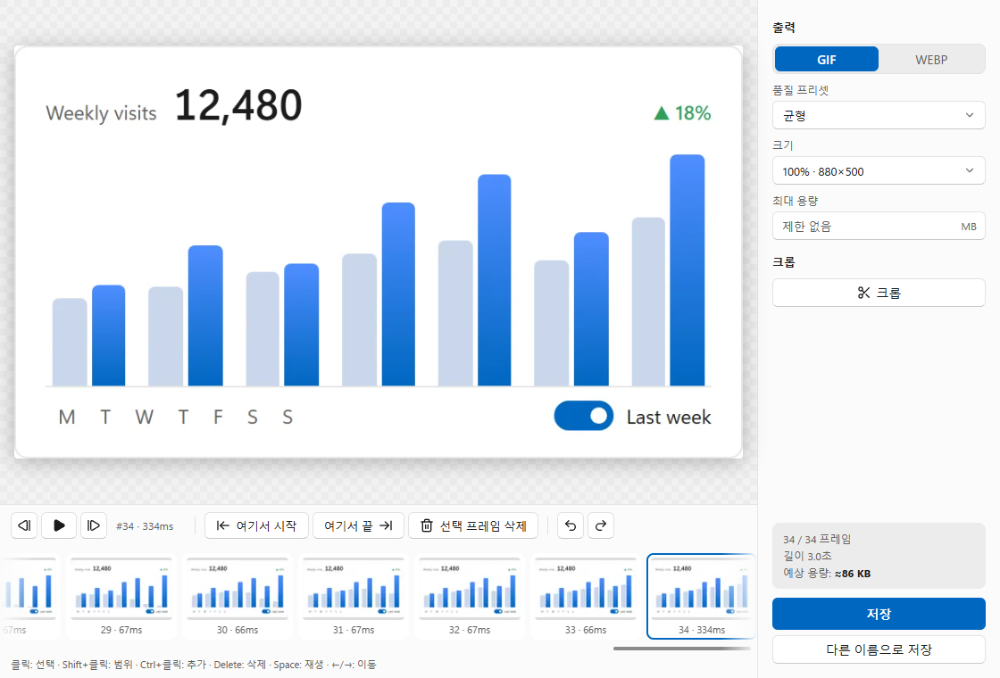
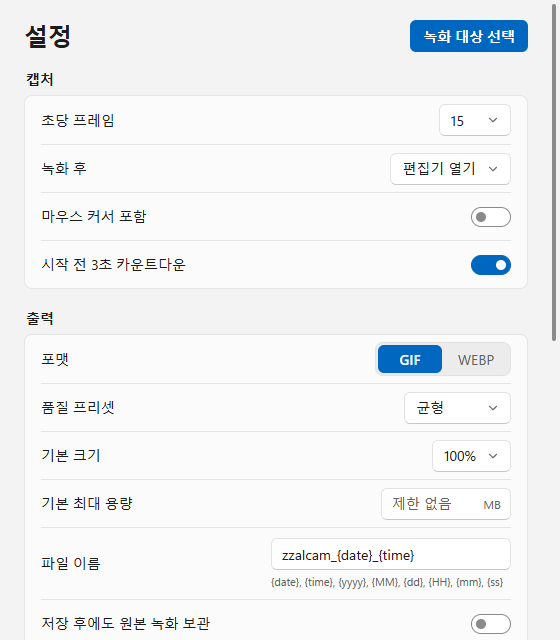

# zzalcam

**Windows용 빠르고 가벼운 GIF·애니메이션 WebP 화면 녹화기.**

[웹사이트](https://raravel.github.io/zzalcam/ko/) · [English](README.md) · [변경 기록](CHANGELOG.md) · [설계 문서](docs/design.md)

<p align="center">
  
</p>

zzalcam은 창, UI 컨트롤 하나, 드래그한 영역, 모니터 하나 또는 전체 모니터를 녹화해서, 보기 좋은 화질을 유지하는 선에서 최대한 작은 GIF나 WebP로 만듭니다. 10초 클립을 저장하는 데 몇 초면 충분합니다.

## 기능

- **무엇이든 선택** — 단축키 하나로 모든 모니터에 선택 화면이 뜹니다. 드래그하면 영역, 클릭하면 창, `Tab`을 누르면 UI Automation으로 컨트롤(버튼, 패널, 목록 등) 하나, `F`는 커서가 있는 모니터, `A`는 전체 모니터입니다. 돋보기로 픽셀 단위까지 맞출 수 있습니다.
- **바뀔 때만 기록** — 화면이 바뀔 때만 프레임을 저장합니다(가변 프레임레이트). 멈춰 있는 시간은 이전 프레임을 더 오래 보여 주는 것으로 처리합니다.
- **프레임별 최적화**
  - GIF 프레임마다 바뀐 영역만 잘라 저장하고, 바뀌지 않은 픽셀은 투명으로 처리합니다.
  - 팔레트는 하나를 공유하고, 공유 팔레트로는 화질이 떨어지는 프레임만 따로 팔레트를 씁니다.
  - 디더링을 안정적으로 유지해서 정지한 부분이 깜빡이지 않습니다.
- **GIF 또는 WebP** — WebP 서브프레임은 모든 코어에서 병렬로 인코딩합니다.
- **용량 목표** — "8MB 이하로" 같은 목표를 주면 품질, 프레임레이트, 크기 순서로 낮춰 맞추고 무엇을 바꿨는지 알려 줍니다.
- **편집기** — 트림, 프레임 삭제, 크롭, 실제 속도 미리보기, 실행 취소/다시 실행, 실시간 예상 용량.
- **공유에 최적화** — 저장한 파일을 클립보드에 복사합니다(디스코드, 슬랙 등에 바로 붙여넣기).
- **녹화에 찍히지 않음** — 테두리, 컨트롤 바, 선택 화면, 알림은 녹화에서 제외됩니다.
- 크래시 복구, 한국어·영어 UI, 포터블 모드, 명령줄 도구.

## 스크린샷

<p align="center">
<picture>
  <source media="(prefers-color-scheme: dark)" srcset="docs/images/editor-ko-dark.png">
  
</picture>
<picture>
  <source media="(prefers-color-scheme: dark)" srcset="docs/images/settings-ko-dark.png">
  
</picture>
</p>

## 설치

[Releases](https://github.com/raravel/zzalcam/releases)에서 설치 파일이나 포터블 zip을 받으세요.

- Windows 10 2004 이상, x64.
- 설치 파일은 Microsoft WebView2가 없으면 함께 설치합니다(Windows 11에는 기본 포함). 포터블 버전은 WebView2가 이미 설치돼 있어야 합니다.
- 아직 코드 서명을 하지 않아서 처음 실행할 때 SmartScreen 경고가 뜰 수 있습니다(*추가 정보 → 실행*).

포터블 zip에는 `zzalcam.portable` 파일이 들어 있습니다. 그래서 설정과 원본 녹화 세션을 `zzalcam.exe` 옆의 `data` 폴더에 저장하고, 자동 업데이트는 하지 않습니다. 저장한 GIF·WebP 파일은 설정에서 고른 저장 폴더(기본값 `사진\zzalcam`)로 갑니다.

## 사용법

| 동작 | 기본 단축키 |
|---|---|
| 대상 선택 후 녹화 / 정지 | `Alt+Shift+1` |
| 일시정지 / 재개 | `Alt+Shift+2` |
| 마지막 대상 다시 녹화 | `Alt+Shift+3` |
| 녹화 취소 (알림에서 되돌리기 가능) | `Alt+Shift+X` |

단축키는 설정에서 바꿀 수 있습니다. 다른 프로그램이 이미 쓰는 조합이면 표시해 줍니다.

선택 화면의 조작은 다음과 같습니다.

| 조작 | 동작 |
|---|---|
| 드래그 | 영역 선택 |
| 클릭 | 창 선택 |
| `Tab` | 컨트롤 모드 (휠로 상위/하위 요소 이동) |
| `F` | 커서가 있는 모니터 |
| `A` | 전체 모니터 |
| 방향키 | 커서를 1픽셀 이동 (`Shift`를 누르면 10픽셀) |
| `Esc` 또는 우클릭 | 취소 |

녹화가 끝나면 편집기가 열립니다. 설정에서 바로 저장하도록 바꿀 수 있습니다.

### 명령줄

`zzalcam-cli.exe`는 포터블 zip과 Releases 페이지에 들어 있습니다.

```
zzalcam-cli list monitors
zzalcam-cli list windows
zzalcam-cli record --monitor 1 --duration 5s -o clip.gif
zzalcam-cli record --window "메모장" --fps 30 -o clip.webp
zzalcam-cli record --region 100,100,800,600 --max-size 8MB -o clip.gif
zzalcam-cli encode <session.zzcs> --preset smallest --scale 0.5 -o clip.gif
```

녹화는 `Ctrl+C`로 멈춥니다. 인코딩 중에 `Ctrl+C`를 한 번 더 누르면 중단합니다.

## 성능

측정 환경은 16스레드 데스크톱 CPU이고, 1920×1080 영역을 15fps로 10초(149프레임) 녹화했습니다.

| | |
|---|---|
| 녹화 중 CPU | 시스템 전체의 약 1% |
| 정지 → GIF 저장 완료 | 2.75초 |

같은 149프레임을 [gifski](https://gif.ski)와 비교했습니다.

| | 용량 | PSNR | 인코딩 시간 |
|---|---|---|---|
| gifski `--quality 70` | 1374 KB | 36.1dB | 6.5초 |
| zzalcam, 디더링 끔 | **947 KB** | 36.1dB | — |
| zzalcam, balanced 프리셋 | 1074 KB | 35.7dB | 2.9초 |

같은 화질(PSNR)에서 용량이 약 31% 작습니다. PSNR은 디더링에 불리한 지표라서, 부드러운 그라데이션을 위해 디더링을 켠 balanced 프리셋은 점수가 조금 낮게 나옵니다.

같은 PC에서 합성 벤치마크(1080p, UI 조작 150프레임, CI에서도 실행)는 GIF를 약 2초, WebP를 1초 안에 인코딩합니다. 직접 돌리려면 `cargo run --release -p zzalcam-encode --example bench`를 실행하세요.

## 소스에서 빌드

필요한 것은 Rust(stable, MSVC 툴체인), Node.js 22, pnpm 10입니다.

```
cd app
pnpm install
cargo tauri dev          # 앱 실행 (cargo install tauri-cli --version "^2")
cargo tauri build        # target/release/bundle에 설치 파일 생성
cargo test --workspace   # 저장소 루트에서 실행
```

| 경로 | 내용 |
|---|---|
| `crates/zzalcam-core` | 프레임, 변화 감지, 세션 파일, 비파괴 편집 |
| `crates/zzalcam-capture` | DXGI Desktop Duplication, Windows.Graphics.Capture, 커서 |
| `crates/zzalcam-encode` | GIF(libimagequant)·WebP(libwebp) 인코더, 내보내기 파이프라인 |
| `crates/zzalcam-overlay` | 선택 화면과 녹화 테두리 (Direct2D layered window) |
| `crates/zzalcam-cli` | 명령줄 도구 |
| `app` | Tauri 2 앱 (`src-tauri`는 Rust, `src`는 Svelte UI) |

## 라이선스

[GPL-3.0-or-later](LICENSE). zzalcam은 [libimagequant](https://pngquant.org/lib/)(GPL-3.0)와 [libwebp](https://chromium.googlesource.com/webm/libwebp)(BSD)를 사용합니다. 모든 릴리스에 `THIRD_PARTY_LICENSES.html`이 포함됩니다.
