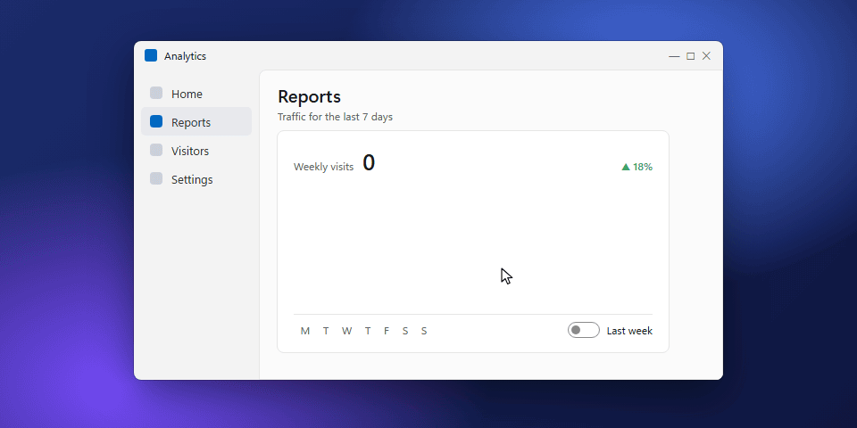
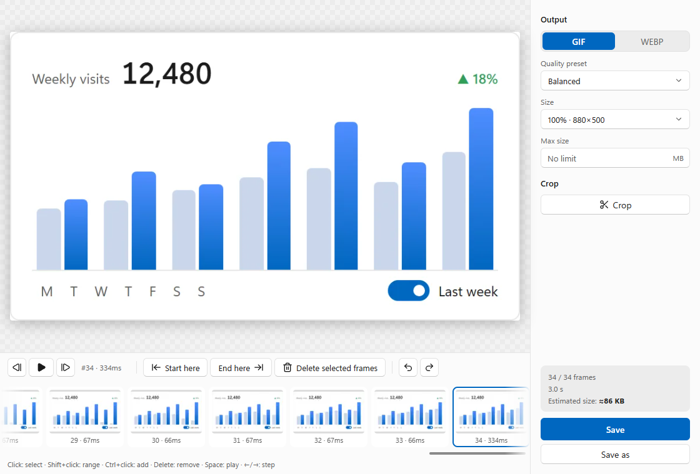
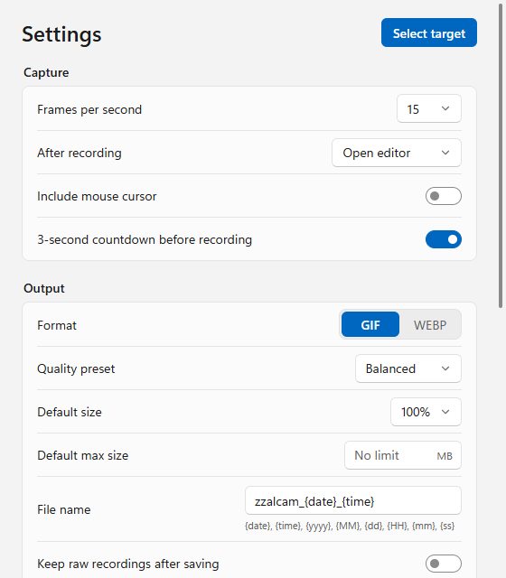

# zzalcam

**Fast, small GIF and animated WebP screen recordings for Windows.**

[한국어](README.ko.md) · [Changelog](CHANGELOG.md) · [Design notes](docs/design.md)

<p align="center">
  
</p>

zzalcam records a window, a single UI control, a dragged region, one monitor or all of them, and
turns it into a GIF or WebP that is as small as it can be without looking worse — fast enough that
saving a 10-second clip takes a couple of seconds.

## Features

- **Pick anything** — one hotkey opens a picker over every monitor: drag a region, click a window,
  press `Tab` to pick a single control (button, panel, list…) through UI Automation, `F` for the
  monitor under the cursor, `A` for all monitors. A live magnifier helps with pixel-exact edges.
- **Records only what changes** — frames are stored when the screen changes (variable frame rate);
  idle time simply lengthens the previous frame.
- **Optimised per frame** — every GIF frame is cropped to what changed, unchanged pixels become
  transparent, one global palette is shared (with per-frame palettes only where it would look bad),
  and dithering is kept stable so static areas never flicker.
- **GIF or WebP** — WebP sub-frames are encoded in parallel on all cores.
- **Size targets** — "keep it under 8 MB": zzalcam lowers quality, then frame rate, then size until it fits,
  and tells you what it changed.
- **Editor** — trim, delete frames, crop, preview at real speed, undo/redo, live size estimate.
- **Made for sharing** — the saved file is copied to the clipboard (paste straight into Discord, Slack, …).
- **Never in the shot** — the border, control bar, picker and notifications are excluded from capture.
- Crash recovery, Korean and English UI, portable mode, a command-line tool.

## Screenshots

<p align="center">
<picture>
  <source media="(prefers-color-scheme: dark)" srcset="docs/images/editor-en-dark.png">
  
</picture>
<picture>
  <source media="(prefers-color-scheme: dark)" srcset="docs/images/settings-en-dark.png">
  
</picture>
</p>

## Install

Download the installer or the portable zip from [Releases](https://github.com/raravel/zzalcam/releases).

- Windows 10 version 2004 or later, x64.
- The installer sets up Microsoft WebView2 if it is missing (it ships with Windows 11).
  The portable build expects WebView2 to be installed already.
- Releases are not code-signed yet, so SmartScreen may warn on first launch
  (*More info → Run anyway*).

The portable zip keeps settings and raw recordings in a `data` folder next to `zzalcam.exe`
(because of the `zzalcam.portable` file) and does not update itself. Saved GIFs / WebPs still go to
the output folder chosen in Settings (`Pictures\zzalcam` by default).

## Use

| Action | Default hotkey |
|---|---|
| Pick a target and record / stop | `Alt+Shift+1` |
| Pause / resume | `Alt+Shift+2` |
| Record the last target again | `Alt+Shift+3` |
| Cancel the recording (can be undone from the notification) | `Alt+Shift+X` |

Hotkeys can be changed in Settings; a combination another program already uses is flagged.

In the picker: drag = region · click = window · `Tab` = control mode (mouse wheel walks to parent /
child elements) · `F` = monitor · `A` = all monitors · arrow keys nudge the cursor by one pixel
(`Shift` = 10) · `Esc` or right click = cancel.

After recording, the editor opens (or the file is saved straight away — see Settings).

### Command line

`zzalcam-cli.exe` ships with the portable zip and on the Releases page.

```
zzalcam-cli list monitors
zzalcam-cli list windows
zzalcam-cli record --monitor 1 --duration 5s -o clip.gif
zzalcam-cli record --window "Notepad" --fps 30 -o clip.webp
zzalcam-cli record --region 100,100,800,600 --max-size 8MB -o clip.gif
zzalcam-cli encode <session.zzcs> --preset smallest --scale 0.5 -o clip.gif
```

Recording stops with `Ctrl+C` (a second `Ctrl+C` while encoding aborts).

## Performance

Measured on a 16-thread desktop CPU, recording a 1920×1080 region at 15 fps for 10 s (149 frames):

| | |
|---|---|
| CPU while recording | about 1 % of the machine |
| Stop → GIF saved | 2.75 s |

Against [gifski](https://gif.ski) on the same 149 frames:

| | Size | PSNR | Encode time |
|---|---|---|---|
| gifski `--quality 70` | 1374 KB | 36.1 dB | 6.5 s |
| zzalcam, dithering off | **947 KB** | 36.1 dB | — |
| zzalcam, balanced preset | 1074 KB | 35.7 dB | 2.9 s |

At equal PSNR the file is about 31 % smaller. (PSNR penalises dithering, which is why the balanced
preset, dithered for smoother gradients, scores a little lower.)

On the same machine the synthetic benchmark (1080p, 150 frames of UI activity, also run in CI)
encodes GIF in about 2 s and WebP in under 1 s; run it with
`cargo run --release -p zzalcam-encode --example bench`.

## Build from source

Requirements: Rust (stable, MSVC toolchain), Node.js 22 and pnpm 10.

```
cd app
pnpm install
cargo tauri dev          # run the app (cargo install tauri-cli --version "^2")
cargo tauri build        # installer in target/release/bundle
cargo test --workspace   # from the repository root
```

| Path | What |
|---|---|
| `crates/zzalcam-core` | frames, change detection, session file, non-destructive edits |
| `crates/zzalcam-capture` | DXGI Desktop Duplication, Windows.Graphics.Capture, cursor |
| `crates/zzalcam-encode` | GIF (libimagequant) and WebP (libwebp) encoders, export pipeline |
| `crates/zzalcam-overlay` | the picker and recording border (Direct2D layered windows) |
| `crates/zzalcam-cli` | command-line tool |
| `app` | Tauri 2 app (Rust in `src-tauri`, Svelte UI in `src`) |

## License

[GPL-3.0-or-later](LICENSE). zzalcam uses [libimagequant](https://pngquant.org/lib/) (GPL-3.0) and
[libwebp](https://chromium.googlesource.com/webm/libwebp) (BSD); every release includes
`THIRD_PARTY_LICENSES.html`.
